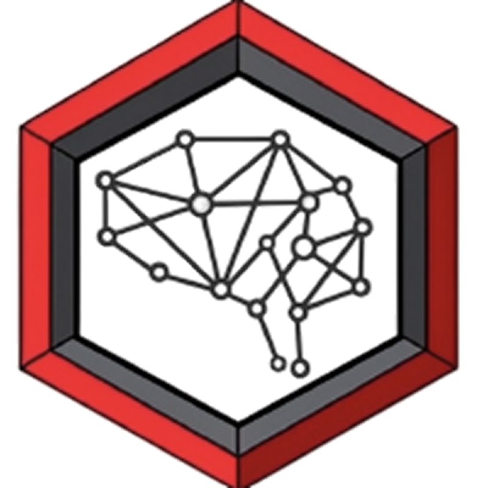
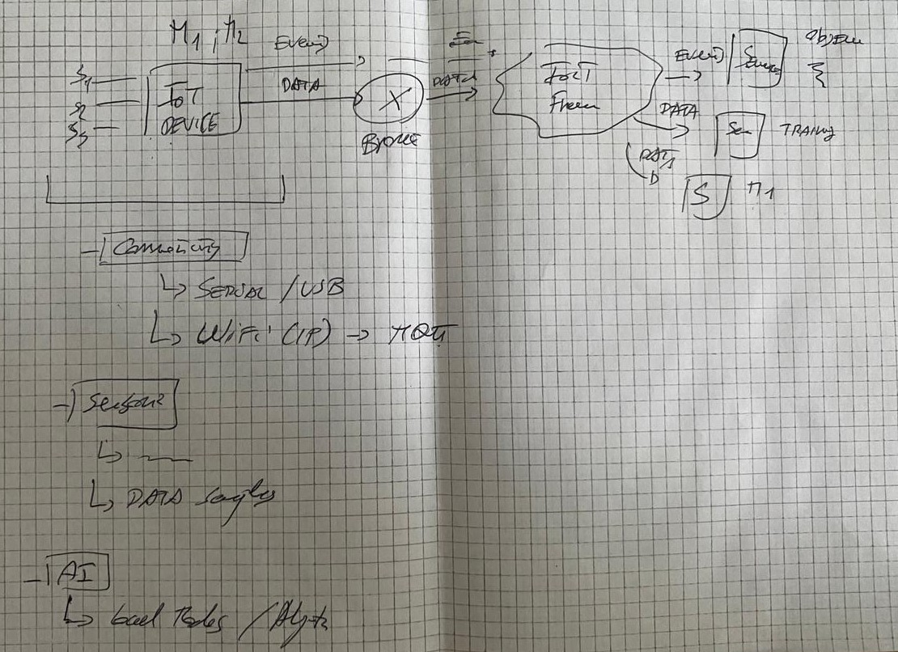

# Nicla Vision Anomaly Detection
<p align="center">
    
    &nbsp;&nbsp;&nbsp;&nbsp;&nbsp;&nbsp;&nbsp;&nbsp;&nbsp;&nbsp;
    
</p>
This project aims to implement anomaly detection using the Nicla Vision board.

Currently, the project documents the intelligence phase, including implementation of machine vision and the YOLOv8n model.

## Table of Contents

- [Current status](#current-status)
- [Research path](#research-path)
  - [Connectivity](#connectivity)
  - [Sensors and streaming](#sensors-and-streaming)
- [Next steps](#next-steps)
- [How to run the demos](#how-to-run-the-demos)
- [Notes](#notes)
- [Authorship](#authorship)

# Current status

This repo currently contains:
- **basics** folder, containing steps taken to understand board's sensors and mqtt broker
- **record_and_stream** folder, containing functional streaming and recording flows of both camera and microphone
- **intelligence** folder, currently containing the development of machine vision and anomaly detection using OpenCV and YOLOv8n.

# Research path

<p align="center">
    
</p>

> Project's original sketch

The project's development has been split into 3 areas:
* Connectivity
* Boards sensors and streaming
* Machine Vision

## Connectivity

The board comes equipped with an antenna, and can connect to Bluetooth and WiFi. For our project, we chose to use MQTT and the [*Mosquitto*](https://mosquitto.org/) broker to subscribe and publish messages.

The design of the communication architecture can be seen below.

<p align="center">
    
</p>

### MQTT setup

#### Local broker

As seen in our repo's *mqtt_pub.py* code, the broker may run on the same machine as the board, where it can subscribe to any topic of choice. This can be done running ``mosquitto_sub -h localhost -t "<topic-name>" -v`` on a terminal, and, in your code, connecting to your machine's local ip address.

#### External broker

To connect to a broker already running in a different machine, you'd connect to their local IP address (if the board and the machine are on the same WiFi), or you'd connect to their public IP or domain (if they are running on different connections), as can be seen on the example below.

> ``client = MQTTClient("openmv", "broker.university.edu", port=1883)``  
> ``client.connect()``

## Sensors and streaming

The board comes equipped with a microphone and a camera. As a means to understand the connectivity and capabilities of those features, a streamer+recorder feature for both the microphone and camera was developed in the repo.

The files inside the **"record_and_stream"** folder are responsible for those features, and work according to the following sketch:

<p align="center">
    
</p>

As can be seen by the sketch, the flow works via 2 concurrent programs. One of them runs from the board and aims to capture and send sensor data in real-time.
The other aims to capture such data through the broker connection and save that data into a playable file on the repo.

# Next steps
Our next steps are focused towards implementing intelligence. They are:
* Understanding intelligence and implementing it on our machine for both audio (with librosa) and video (with YOLOv8n).
* Moving the intelligence to the board using TinyML.
* Making this approach dynamic with the board (currently open for discussion).

# How to run the demos

## Initial Setup

All demos require the same initial setup:

1. **Create and activate a virtual environment:**
   ```bash
   python3 -m venv .venv
   source .venv/bin/activate
   ```

2. **Install dependencies:**
   ```bash
   pip install -r requirements.txt
   ```

## yolo_detector

Captures video from your webcam and runs YOLOv8n object detection on each frame, drawing bounding boxes around detected objects.

### Running the demo

```bash
python3 intelligence/yolo_detector.py
```

## mjpeg_creator

Receives video frames via MQTT from the Nicla Vision board and saves them as an AVI video file. Requires an active MQTT broker and a board streaming camera data.

### Prerequisites

Make sure the board is running `camera_streamer.py` and publishing video frames to the MQTT topic.

### Running the demo

```bash
python3 record_and_stream/concurr_programs/mjpeg_creator.py
```

The recorded video will be saved to `record_and_stream/recordings/video_recording.avi`.

## wav_creator

Receives audio data via MQTT from the Nicla Vision board and saves it as a WAV audio file. Requires an active MQTT broker and a board streaming audio data.

### Prerequisites

Make sure the board is running `microphone_streamer.py` and publishing audio data to the MQTT topic.

### Running the demo

```bash
python3 record_and_stream/concurr_programs/wav_creator.py
```

The recorded audio will be saved to `record_and_stream/recordings/recording.wav`.

# Notes
This repository intentionally keeps intermediate code as part of the research trail, as a means of registering the building process towards our final project. The file names and this documentation will always reflect this choice.

# Authorship
* Development: [Otávio Sbampato Andrade](https://github.com/otaviosbampato)
* Advisor: [Marco Picone](https://github.com/piconem)