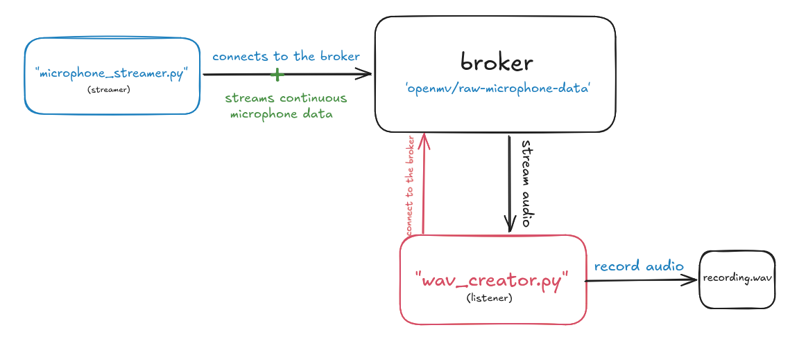

# Project overview

This project aims to implement anomaly detection using the Nicla Vision board.

Currently, the project documents the exploration phase, built towards that goal.

# Current status

This repo currently contains:
- *basics* folder, containing steps taken to understand board's sensors and mqtt broker
- *record_and_stream* folder, containing functional streaming and recording flows of both camera and microphone

# Research path

    

> Project's original sketch

The project's development has been split into 3 areas:
* Connectivity
* Boards sensors and streaming
* Machine Vision

## Connectivity

The board comes equipped with an antenna, and can connect to Bluetooth and WiFi. For our project, we chose to use MQTT and the *mosquitto* broker to subscribe and publish messages.

The design of the communication architecture can be seen below.

    

### MQTT setup

#### Local broker

As seen in our repo's *mqtt_pub.py* code, the broker may run on the same machine as the board, where it can subscribe to any topic of choice. This can be done running ``mosquitto_sub -h localhost -t "<topic-name>" -v`` on a terminal, and, in your code, connecting to your machine's local ip address.

#### External broker

To connect to a broker already running in a different machine, you'd connect to their local IP address (if the board and the machine are on the same WiFi), or you'd connect to their public IP or domain (if they are running on different connections), as can be seen on the example below.

> ``client = MQTTClient("openmv", "broker.university.edu", port=1883)``  
> ``client.connect()``

## Sensors and streaming

The board comes equipped with a microphone and a camera. As a means to understand the connectivity and capabilities of those features, a streamer+recorder feature for both the microphone and camera was developed in the repo.

The files inside the **"record_and_stream"** folder are responsible for those features, and work according to the following sketch:

    

As can be seen by the sketch, the flow works via 2 concurrent programs. One of them runs from the board and aims to capture and send sensor data in real-time.
The other aims to capture such data through the broker connection and save that data into a playable file on the repo.

# Next steps
Implementing intelligence.
* Firstly, we will understand intelligence and implement it on our machine only, both audio with librosa and video with YOLOv8n.
* Then, we will move such intelligence to the board, using TinyML.
* Finally, we aim to make this a dynamic approach with the board (currently open topic for discussion).

# Notes
* This repository intentionally keeps intermediate code as part of the research trail, as a means of registering the building process towards our final project. The file names and this documentation will always reflect this choice.

# Authorship
* Development: [Otávio Sbampato Andrade](https://github.com/otaviosbampato)
* Advisor: [Marco Picone](https://github.com/piconem)