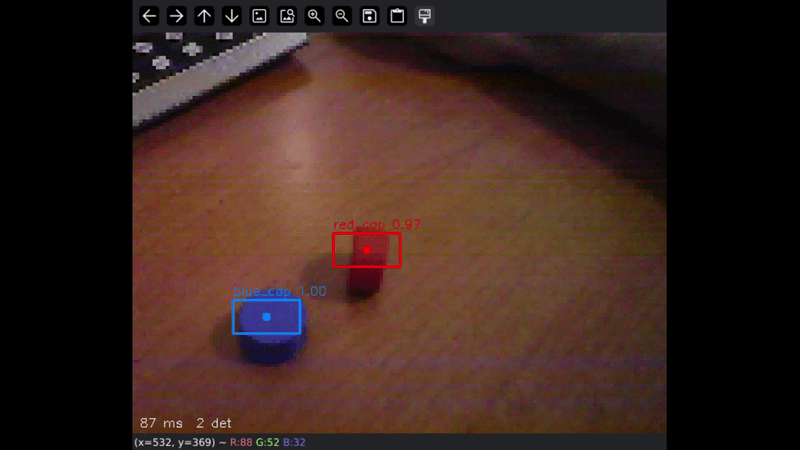

# Edge AI on the Arduino Nicla Vision

> Offline soda-cap detection on the Nicla Vision, with a live PC viewer.

<p align="center">
    
    &emsp;&emsp;
    
</p>

**Status:** FOMO detection of blue and red caps runs on the board, with no network needed. Keyword spotting is in development.

<p align="center">
    
    <br/><em>Live detection of the blue and red caps</em>
</p>

**Quick links:** [Board demo: detection on the Nicla](docs/board-fomo.md) · [Documentation](#documentation) · [Project structure](#project-structure)

## Table of Contents

- [Project structure](#project-structure)
- [Status](#status)
- [Documentation](#documentation)
- [Run the demos](#run-the-demos)
- [Authorship](#authorship)

## Project structure

```text
arduino-nicla-vision-playground/
├── board/
│   ├── fomo_live/          # Arduino C++: FOMO inference, streams results and frames to the PC
│   ├── streaming/          # MicroPython: camera and microphone streamers (run from OpenMV IDE)
│   └── examples/           # MicroPython: sensor and MQTT basics
├── host/
│   ├── vision/             # PC: YOLOv8n webcam demo and FOMO live viewer
│   ├── audio/              # PC: melspectrogram and keyword spotting (in progress)
│   └── receivers/          # PC: MQTT receivers that save video and audio
├── models/                 # trained weights and board firmware
├── tools/                  # dataset preparation and training scripts
├── docs/                   # detailed documentation
├── assets/                 # images and GIFs for the docs
└── recordings/             # receiver output (gitignored)
```

## Status

- **Done:** MQTT and sensor streaming
- **Done:** desktop vision prototype, YOLOv8n trained on blue and red caps
- **Done:** on-board vision, FOMO model running offline on the Nicla Vision
- **In progress:** keyword-spotting model
- **Planned:** on-board audio inference, then anomaly detection using vision and audio on the board

<p align="center">
    
    <br/><em>Project's initial concept</em>
</p>

## Documentation

| Phase                                      | Description                                                                                                 |
| ------------------------------------------ | ----------------------------------------------------------------------------------------------------------- |
| [Connectivity](docs/connectivity.md)       | Board and PC talk over MQTT, with a local Mosquitto broker or an external one                               |
| [Sensors and streaming](docs/streaming.md) | Camera and microphone are streamed to the PC and saved as MJPEG video and WAV audio                         |
| [Intelligence](docs/intelligence.md)       | YOLOv8n on the PC: blue and red caps, mAP50 0.94 on test. Also the training data and the desktop baseline   |
| [On-board detection](docs/board-fomo.md)   | FOMO runs offline on the Nicla: 94% blue and 84% red recall on validation, live boxes and centroids on a PC |

## Run the demos

### Board: offline FOMO detection

Runs the FOMO model on the Nicla Vision with no network, and shows boxes and centroids in a PC window. Details, model numbers, and limitations are in [docs/board-fomo.md](docs/board-fomo.md).

**Needs:** Nicla Vision on USB, [arduino-cli](https://arduino.github.io/arduino-cli/) (or the Arduino IDE), and the Edge Impulse Arduino library for this model (Deployment → Arduino library in Edge Impulse). Install the library zip in the Arduino IDE (Sketch → Include Library → Add .ZIP Library).

1. **Flash the sketch** (replaces the Edge Impulse firmware on the board):

   ```bash
   arduino-cli compile --fqbn arduino:mbed_nicla:nicla_vision board/fomo_live
   arduino-cli upload -p /dev/ttyACM0 --fqbn arduino:mbed_nicla:nicla_vision board/fomo_live
   ```

2. **Start the viewer** (after the Python setup below):

   ```bash
   python3 host/vision/fomo_viewer.py --port /dev/ttyACM0
   ```

   Press `q` in the window to quit.

> [!NOTE]
> To go back to the original Edge Impulse firmware, run `flash_linux.sh` (or the Windows/Mac script) in `models/nicla-vision-caps-detection-nicla-vision-v1-impulse-#1/`.

### Python setup

From the root folder:

```bash
python3 -m venv .venv
source .venv/bin/activate
pip install -r host/requirements.txt
```

For the board viewer only, `pip install opencv-python numpy pyserial` is enough.

### Other demos

The older desktop and streaming demos are documented with their docs:

- YOLOv8n webcam detection (`host/vision/yolo_detector.py`): [docs/intelligence.md](docs/intelligence.md)
- Melspectrogram (`host/audio/mel_spectrogram.py`): [docs/intelligence.md#audio](docs/intelligence.md#audio)
- MQTT receivers that save video and audio (`host/receivers/`): [docs/streaming.md](docs/streaming.md)

## Authorship

- Development: [Otávio Sbampato Andrade](https://github.com/otaviosbampato)
- Advisor: [Marco Picone](https://github.com/piconem)
