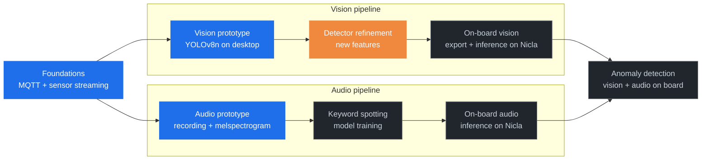

# Edge AI on the Arduino Nicla Vision
> Audio and vision intelligence for IoT: object detection and keyword spotting on the Nicla Vision board.
<p align="center">
    
    &emsp;&emsp;
    
</p>

**Status:** development of intelligence exploratory phase (YOLOv8n).

<!-- ! add a GIF here showing the board doing object vision -->

## Table of Contents

- [Current status](#current-status)
- [Roadmap](#roadmap)
- [Documentation](#documentation)
- [How to run the demos](#how-to-run-the-demos)
- [Authorship](#authorship)

## Structure of the project

```text
nicla-vision-anomaly-detection/
├── board/                  # MicroPython, runs on the Nicla (deployed via OpenMV IDE)
│   ├── examples/           # sensor and MQTT basics
│   ├── streaming/          # camera and microphone streamers
│   ├── vision/             # [planned] on-board inference (TinyML)
│   └── audio/              # [planned] on-board keyword spotting
├── host/                   # CPython, runs on the PC
│   ├── receivers/          # MQTT subscribers that save video/audio
│   ├── vision/             # YOLOv8n object detection
│   └── audio/              # [planned] melspectrogram and keyword spotting
├── models/                 # [planned] trained/downloaded weights
├── tools/                  # helper scripts
├── recordings/             # output of the receivers (gitignored)
├── docs/                   # detailed documentation
└── assets/                 # images and GIFs for the docs
```

## Roadmap



<sub>Solid blue: completed · Orange: in development · Dashed: planned</sub>

<p align="center">
    
    <br/><em>Project's initial concept</em>
</p>

## Documentation

Each phase of the project is documented in detail on its own page:

| Phase | Description | Doc |
|-------|-------------|-----|
| Connectivity | MQTT architecture, local and external brokers | [docs/connectivity.md](docs/connectivity.md) |
| Sensors and streaming | Camera and microphone recording and streaming | [docs/streaming.md](docs/streaming.md) |
| Intelligence | YOLOv8n object detection, melspectrograms, keyword spotting | [docs/intelligence.md](docs/intelligence.md) |

## How to run the demos

From root folder:
1. **Initialize the virtual environment:**
   ```bash
   python3 -m venv .venv
   source .venv/bin/activate
   ```

2. **Install dependencies:**
   ```bash
   pip install -r host/requirements.txt
   ```

### `yolo_detector.py`

Captures video from your webcam and runs YOLOv8n object detection on each frame, drawing bounding boxes around detected objects.

```bash
python3 host/vision/yolo_detector.py
```

### `mel_spectrogram.py`

Records audio from your device and plots a melspectrogram based on the acquired audio.

```bash
python3 host/audio/mel_spectrogram.py
```

### `mjpeg_creator.py`

Receives video frames via MQTT from the Nicla Vision board and saves them as an AVI video file. Requires an active MQTT broker and a board streaming camera data.

> [!IMPORTANT]
> Make sure the board is running `camera_streamer.py` and publishing video frames to the MQTT topic.

```bash
python3 host/receivers/mjpeg_creator.py
```

The recorded video will be saved to `recordings/video_recording.avi`.

### `wav_creator.py`

Receives audio data via MQTT from the Nicla Vision board and saves it as a WAV audio file. Requires an active MQTT broker and a board streaming audio data.

> [!IMPORTANT]
> Make sure the board is running `microphone_streamer.py` and publishing audio data to the MQTT topic.


```bash
python3 host/receivers/wav_creator.py
```

The recorded audio will be saved to `record_and_stream/recordings/recording.wav`.

## Authorship
* Development: [Otávio Sbampato Andrade](https://github.com/otaviosbampato)
* Advisor: [Marco Picone](https://github.com/piconem)