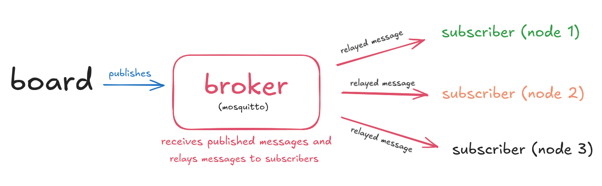

# Connectivity

[← Back to main README](../README.md)

The board comes equipped with an antenna, and can connect to Bluetooth and WiFi. For our project, we chose to use MQTT and the [*Mosquitto*](https://mosquitto.org/) broker to subscribe and publish messages.

The design of the communication architecture can be seen below.

    

<!-- ! GIF: terminal split-screen, board publishing on one side and `mosquitto_sub -v` printing messages on the other -->

## MQTT setup

### Local broker

As seen in our repo's *mqtt_pub.py* code, the broker may run on the same machine as the board, where it can subscribe to any topic of choice. This can be done running ``mosquitto_sub -h localhost -t "<topic-name>" -v`` on a terminal, and, in your code, connecting to your machine's local ip address.

### External broker

To connect to a broker already running in a different machine, you'd connect to their local IP address (if the board and the machine are on the same WiFi), or you'd connect to their public IP or domain (if they are running on different connections), as can be seen on the example below.

> ``client = MQTTClient("openmv", "broker.university.edu", port=1883)``  
> ``client.connect()``