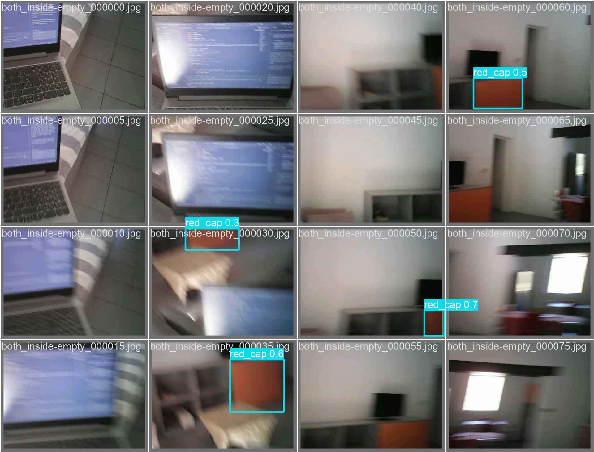
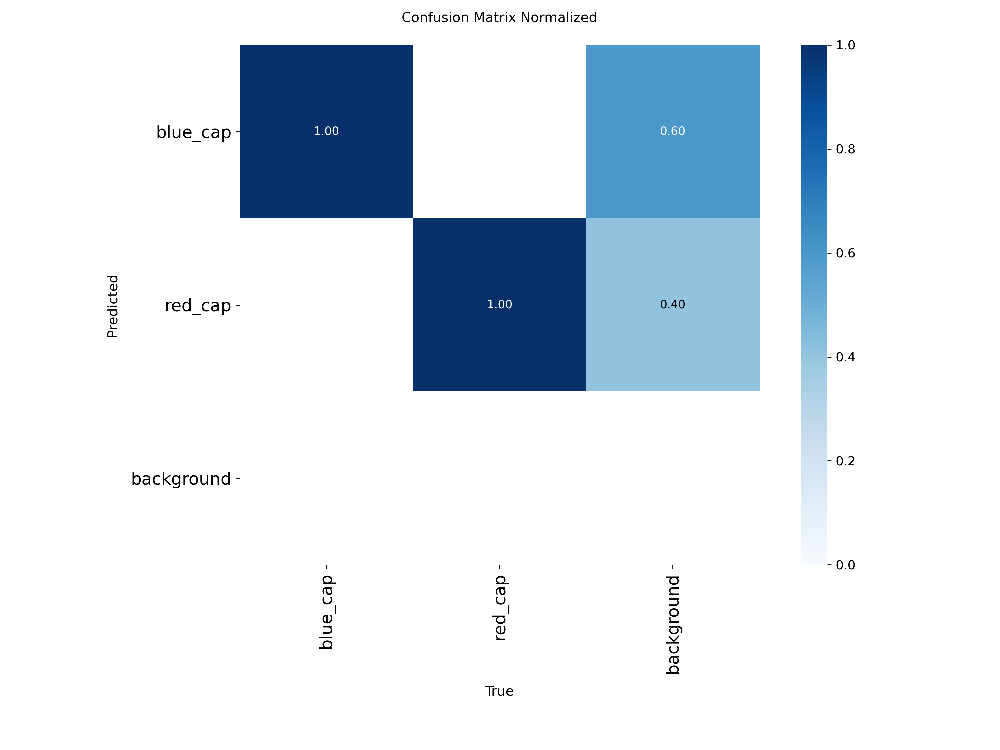

# Intelligence

[← Back to main README](../README.md)

The development of intelligence in the project is split into 2 main different phases. A development phase on a desktop machine using YOLOv8n/openCV for video and librosa/tensorflow for audio, and an integration phase into the board using TinyML.

## Video

Video intelligence on the machine has been developed using openCV, an open-source library for real-time computer vision and image processing. The model used was YOLOv8n, specifically chosen for its small size and interesting didactic value.

The demo *yolo_detector.py* can be seen inside the `host/vision/` folder and it describes the implementation of object detection and classification with bounding boxes, labels and confidence scores over the YOLOv8n model.

### Custom classes: blue and red soda caps

The stock YOLOv8n only knows the 80 COCO classes, and its classification head can't simply be extended with new ones. To detect a **blue cap** and a **red cap**, the pretrained model was fine-tuned (transfer learning) on a small dataset built for this project. The COCO classes are dropped in the process: the fine-tuned model detects only the two caps.

<!-- 📸 GIF: live detection of the blue and red caps from the webcam.
Save it as assets/yolo_caps_demo.gif and replace this comment with:

    
     <em>Live detection of the blue and red caps</em>

-->

The process, from images to model:

1. **Collecting frames:** short videos with blue caps, red caps and both together were recorded, and every 5th frame was extracted as a still image.
2. **Labeling in [CVAT](https://www.cvat.ai/):** the frames were uploaded as tasks, bounding boxes were drawn around each cap with the labels `blue_cap` and `red_cap`, and each task was assigned a subset (Train, Validation or Test). The project was exported in the **YOLO 1.1** format, which gives one `.txt` file per image with the class and the normalized box.
3. **Building the dataset:** CVAT's free tier doesn't allow exporting the images together with the labels, so the export contains only the label files. Each label was matched back to its original frame by file name, and the result was arranged in the Ultralytics folder layout (`images/` and `labels/` split into `train`, `val` and `test`, plus a `data.yaml` with the two class names).
4. **Adding negatives:** new recordings of scenes with no caps (hands, orange objects, rooms) were extracted the same way. They needed no boxes, just an empty label file, and [tools/add_negatives.py](../tools/add_negatives.py) copied them into the dataset. Each recording went to a single split, so near-identical frames from one video never sit in both train and val.
5. **Training on Google Colab:** the dataset was zipped, uploaded to Colab and [tools/train_yolo.py](../tools/train_yolo.py) was run on the free T4 GPU. It fine-tunes `yolov8n.pt` (640 px, up to 100 epochs, early stopping), evaluates the best weights on the validation and test splits and saves the result. Training stopped at epoch 60 (about 4.5 minutes) and kept the weights from epoch 30. The run is saved as `models/soda_caps_run.zip`, and the model as `models/soda_caps_best.pt`.
6. **Using the model:** `yolo_detector.py` loads `models/soda_caps_best.pt` in place of the stock weights.

<!-- 📸 IMAGE: screenshot of the CVAT labeling interface with a blue and a red cap boxed.
Save it as assets/cvat_labeling.png and replace this comment with:

    
     <em>Labeling the caps in CVAT</em>

-->

<!-- 📸 IMAGE (optional): screenshot of the Colab training run (epoch progress and final metrics table).
Save it as assets/colab_training.png and replace this comment with:

    
     <em>Fine-tuning on a free Colab GPU</em>

-->

Two choices worth noting:

- **The split is by recording, not by frame.** Consecutive frames are nearly identical, so a random split would leak training frames into validation and inflate the scores. Training uses the single-color videos (one color per video) and the first negative recording, validation the video with both caps and the second negative recording, and test separate videos not used in training.
- **Hue augmentation is turned off** (`hsv_h=0`). The two classes differ mostly by color, and a hue shift could turn a blue cap into a red one.

| Split | Images | Cap boxes | Images without caps |
|-------|--------|-----------|---------------------|
| Train | 314 | 269 | 49 |
| Validation | 78 | 47 | 48 |
| Test | 72 | 54 | 30 |

The negatives were added after the first training run, so the numbers below are for the current model (`models/soda_caps_best.pt`, epoch 30 of 60).

| Split | mAP50 | mAP50-95 | Precision | Recall |
|-------|-------|----------|-----------|--------|
| Validation | 0.937 | 0.726 | 0.835 | 0.923 |
| Test | 0.940 | 0.701 | 0.794 | 0.946 |

    
     <em>Predictions on the first validation batch, mostly negative frames: a few false <code>red_cap</code> detections on orange and cluttered backgrounds</em>

#### Known limitation: false positives

Real caps are found reliably, but the model also fires on things that are not caps. In live tests the most common false `red_cap` detections are fingers and orange-ish backgrounds. Counting detections against the labels (IoU 0.5), the test split has 54 real caps. At the default confidence threshold of 0.25 the model finds 53 of them, with 26 false detections (10 `red_cap`, 16 `blue_cap`). Raising the threshold to 0.5 cuts the false detections to 17 at the cost of 2 missed caps. The validation split has 47 caps; at 0.25 it finds 44 with 41 false detections (21 `red_cap`, 20 `blue_cap`), and at 0.5 it finds 43 with 15 false detections.

Before the negatives were added, the same test split gave 31 false detections at 0.25 and 22 at 0.5, so the new negatives cut false positives by about 16% at 0.25 and 23% at 0.5.

    
     <em>Normalized confusion matrix on validation: every real cap is detected (diagonal), but the detections on background are split 60% blue / 40% red</em>

The dataset had too few negatives before (28 of 293 training images contained no cap). Adding 42 negatives of hands and orange objects reduced the false detections, and that dataset is also what the FOMO model for the board is trained on.

## Audio

Audio intelligence on the machine is currently undergoing development.

As of now, audio recording and melspectrogram plotting has been implemented and can be seen described on the script *mel_spectrogram.py*, inside the `host/audio/` folder. The libs used were sounddevice for audio recording and librosa for melspectrogram plotting.

<!-- ! 📸 IMAGEs: example melspectrograms of 2-3 different spoken keywords side by side -->

### Keyword spotting (KWS)

A keyword-spotting model for 10 different words is under development.

<!-- 📸 IMAGE: training curves (accuracy/loss) and confusion matrix once the model is done -->
<!-- 📸 GIF: real-time keyword detection demo -->