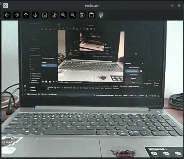
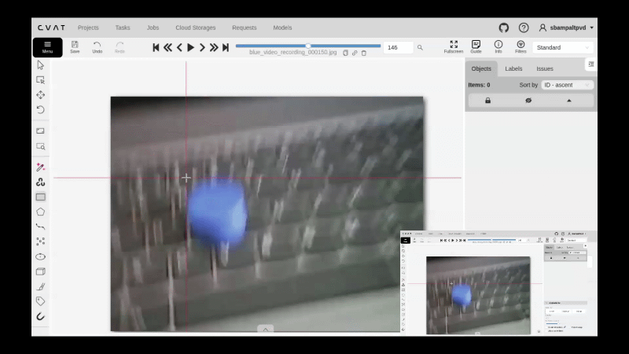
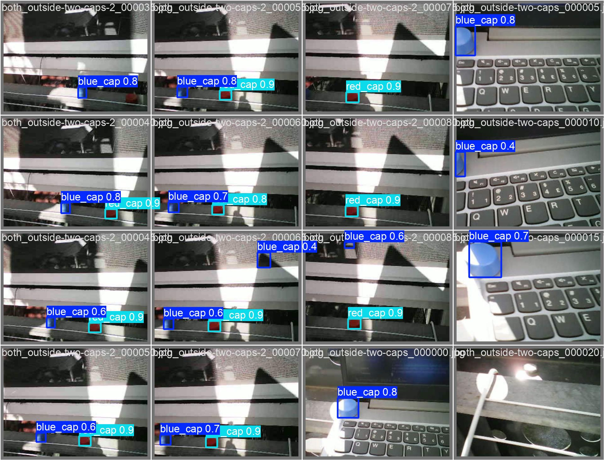

# Intelligence

[← Back to main README](../README.md)

Intelligence is developed in two phases: on the desktop (YOLOv8n/OpenCV for video, librosa/TensorFlow for audio), then on the board (TinyML).

## Video

Video runs on the desktop with OpenCV and YOLOv8n, chosen for its small size. The demo _yolo_detector.py_ in `host/vision/` does object detection with bounding boxes, labels and confidence scores.

### Custom classes: blue and red soda caps

The stock YOLOv8n only knows 80 COCO classes. To detect a **blue cap** and a **red cap**, it was fine-tuned (transfer learning) on a custom dataset. The COCO classes are dropped; the model detects only the two caps.

    
     <em>Live detection of the blue and red caps</em>

Pipeline:

1. **Frames:** short videos of blue caps, red caps and both were recorded; every 5th frame was extracted.
2. **Labeling in [CVAT](https://www.cvat.ai/):** boxes labeled `blue_cap` and `red_cap`, exported in **YOLO 1.1** format.
3. **Dataset:** CVAT's free tier exports labels without images, so labels were matched to frames by file name and arranged in the Ultralytics layout (`images/` and `labels/` split into `train`, `val`, `test`, plus `data.yaml`).
4. **Negatives:** scenes with no caps (hands, orange objects, rooms) were added with empty label files via [tools/add_negatives.py](../tools/add_negatives.py). Each recording goes to a single split.
5. **Training:** on Google Colab (T4 GPU) with [tools/train_yolo.py](../tools/train_yolo.py). Fine-tunes `yolov8n.pt` at 640 px, up to 100 epochs, early stopping. Stopped at epoch 60 (~4.5 min); epoch 30 weights kept. Saved as `models/soda_caps_run.zip` and `models/soda_caps_best.pt`.
6. **Inference:** `yolo_detector.py` loads `models/soda_caps_best.pt`.

    
     <em>Labeling the caps in CVAT</em>

Choices:

- **Split by recording, not by frame**, to avoid leaking near-identical frames into validation. Train: single-color videos and the first negative recording. Validation: the both-caps video and the second negative recording. Test: separate videos.
- **Hue augmentation off** (`hsv_h=0`), since a hue shift could turn blue into red.

| Split      | Images | Cap boxes | Images without caps |
| ---------- | ------ | --------- | ------------------- |
| Train      | 314    | 269       | 49                  |
| Validation | 78     | 47        | 48                  |
| Test       | 72     | 54        | 30                  |

Metrics for the current model (`models/soda_caps_best.pt`, epoch 30 of 60, trained with negatives):

| Split      | mAP50 | mAP50-95 | Precision | Recall |
| ---------- | ----- | -------- | --------- | ------ |
| Validation | 0.937 | 0.726    | 0.835     | 0.923  |
| Test       | 0.940 | 0.701    | 0.794     | 0.946  |

    
     <em>Predictions on a validation batch with both caps on the desk: the blue and red caps are detected in most frames, with confidences mostly between 0.6 and 0.9</em>

#### Known limitation: false positives

Real caps are found reliably, but the model also fires on non-caps, mostly fingers and orange backgrounds. Counts use IoU 0.5 against the labels.

| Split      | Confidence | Caps found | False detections           |
| ---------- | ---------- | ---------- | -------------------------- |
| Test (54)  | 0.25       | 53         | 26 (10 `red_cap`, 16 `blue_cap`) |
| Test (54)  | 0.5        | 52         | 17                         |
| Validation (47) | 0.25  | 44         | 41 (21 `red_cap`, 20 `blue_cap`) |
| Validation (47) | 0.5   | 43         | 15                         |

Before the negatives, the test split had 31 false detections at 0.25 and 22 at 0.5. The negatives cut false positives by about 16% at 0.25 and 23% at 0.5.

    
     <em>Normalized confusion matrix on validation: every real cap is detected (diagonal), but the detections on background are split 60% blue / 40% red</em>

Before the negatives, 28 of 293 training images had no cap. The same dataset trains the FOMO model for the board.

## Audio

Audio is in development. _mel_spectrogram.py_ (in `host/audio/`) records audio with sounddevice and plots melspectrograms with librosa.

<!-- ! 📸 IMAGEs: example melspectrograms of 2-3 different spoken keywords side by side -->

### Keyword spotting (KWS)

A 10-word keyword-spotting model is under development.

<!-- 📸 IMAGE: training curves (accuracy/loss) and confusion matrix once the model is done -->
<!-- 📸 GIF: real-time keyword detection demo -->
