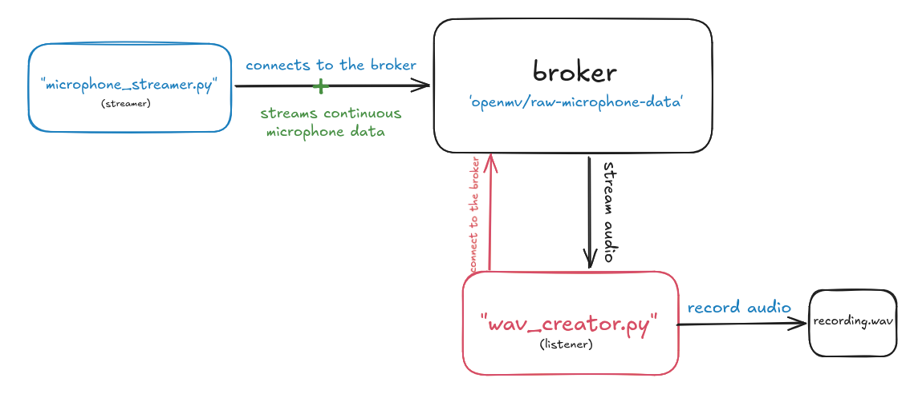

# Sensors and Streaming

[← Back to main README](../README.md)

The board comes equipped with a microphone and a camera. As a means to understand the connectivity and capabilities of those features, a streamer+recorder feature for both the microphone and camera was developed in the repo.

The files inside the **`board/streaming`** and **`host/receivers/`** folders are responsible for those features, and work according to the following sketch:

    

As can be seen by the sketch, the flow works via 2 concurrent programs. One of them runs from the board and aims to capture and send sensor data in real-time.
The other aims to capture such data through the broker connection and save that data into a playable file on the repo.

<!-- ! GIF: live camera stream from the board next to the saved .avi playing back -->

## Running the receivers

See [How to run the demos](../README.md#how-to-run-the-demos) for `mjpeg_creator.py` and `wav_creator.py`.